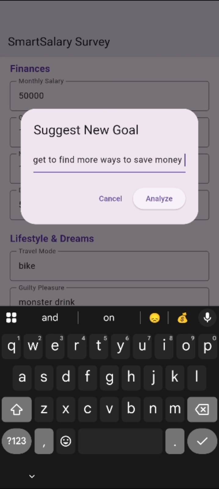
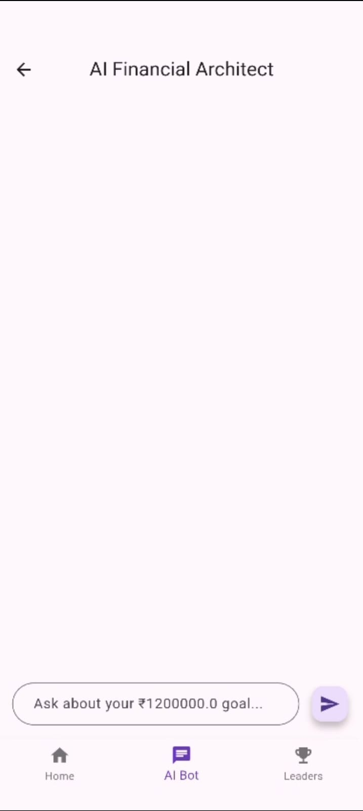
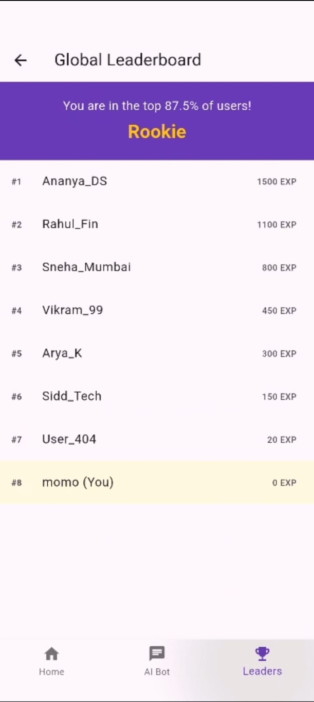

# Formula Money 💸
**A Gamified Financial Habit Maker**

## 🚀 The Mission
Formula Money helps users master their personal finances through a "challenge" format. By combining real-time leaderboards with AI-driven progress analysis, we turn boring budgeting into a competitive game.

## ✨ Features
- **Smart Survey**: Tailored financial goal setting based on user salary and expenses.
- **Daily Task Gamification**: Earn EXP and rank up from "Rookie" to "Absolute Genius."
- **Real-time Global Leaderboard**: Powered by Firebase Firestore to rank users by EXP.
- **Secure Authentication**: Firebase Auth integration for personal progress tracking.

## 🛠️ Tech Stack
- **Frontend**: Flutter (Dart)
- **Backend**: Firebase (Auth & Firestore)
- **AI**: Google Gemini Pro (for monthly progress reports)

## 📸 Screenshots
| Survey | Survey | Goal Confirmation |
|--------|-----------|-----------|
|  |  |  |

| Suggest New Goal | New Goal Approved |
|------|--------------|
|  |  |

| Smart_Salary Dashboard 1 | Smart_Salary Dashboard 2 | Smart_Salary Dashboard 3 |
|--------|-----------|-----------|
|  |  |  |

| AI Bot | Global Leaderboard |
|------|--------------|
|  |  |

## 🏗️ Installation
1. Clone the repo:
   ```bash
   git clone https://github.com/mohit-malpote/Formula_Money-Fintech.git
   ```
   OR
   **Download App:** [Visit here to download the app](https://github.com/mohit-malpote/Formula_Money-Fintech/releases)

   **How to Download app on Android devices:**
   1. Open the releases link on your Android device.
   2. Under **Assets**, download the latest APK file (`Formula-Money.apk`).
   3. Open the downloaded APK on your phone and grant installation permissions.
   4. Launch **Formula Money**.

2. Install dependencies: `flutter pub get`
3. Add your `google-services.json` to `android/app/`
4. Run: `flutter run`

